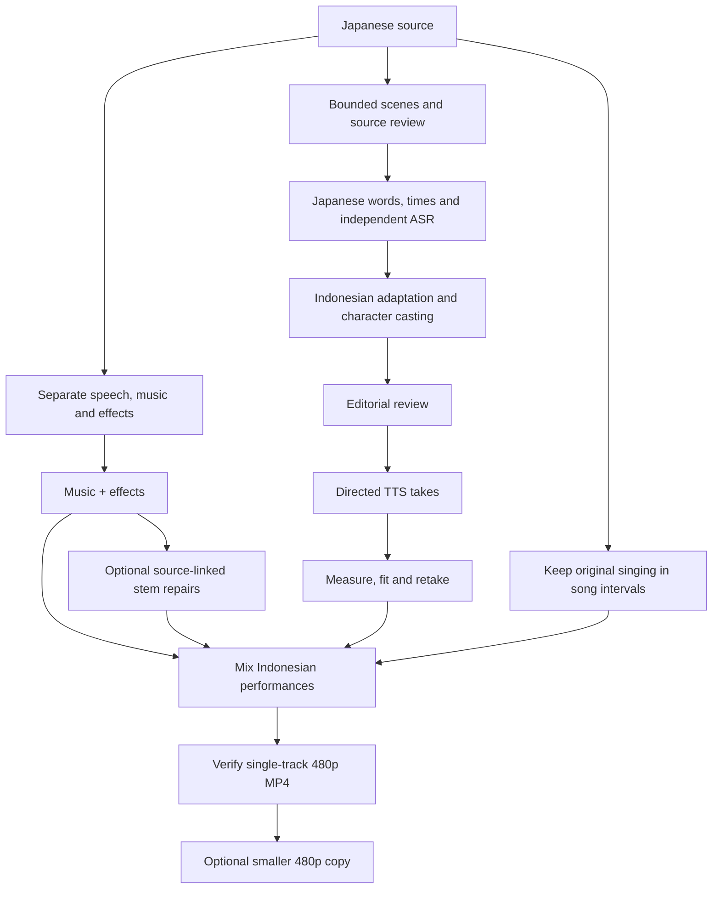

# jp-id-dubber

**Japanese → Bahasa Indonesia dubbing, with directed voices and the original music and effects.**

An opinionated, agent-assisted production workflow. A fresh agent discovers the project-local skill through [AGENTS.md](AGENTS.md), reviews the Japanese source, adapts complete Indonesian performances, casts stable voices, fits actual takes, and exports a compact **480p MP4 with one Indonesian audio track**.

A complete episode exercised **165 directed performances in 24 minutes**, with a verified 480p export and a **34% smaller copy** using unchanged audio. [Measured results and validation →](docs/validation.md)



## What is included

- **A self-contained local skill:** [.agents/skills/jp-id-dubber/SKILL.md](.agents/skills/jp-id-dubber/SKILL.md).
- **Explicit production stages:** source preparation, two ASRs, direct adaptation, review, voices, separation, fitting, mixing and verified delivery.
- **Resumable provider work:** exclusive receipt claims, content-based caches, saved background response IDs and guards against uncertain resubmission.
- **Performance controls:** separate spoken words and acting metadata, stable voice IDs, preserved old takes, pitch-preserving timing limits and local radio filtering when appropriate.
- **Editorial continuity:** relationship-specific pronouns/address, confirmed recurring pronunciations, source-linked timing and explicit vocal-effort decisions.
- **One edit timeline:** frame-resolved picture cuts, exact audio sample boundaries and caption offsets, with continuous picture for adjacent full-episode coverage.
- **Targeted postproduction:** optional residual-vocal cleanup and evidenced instrumental repairs, immutable raw stems and a separate voice-level reference.
- **Reusable pilot takes:** import exact completed voice requests across local episode configs without buying the same performance again.
- **Smaller delivery copies:** encode from the source picture while copying the existing dub audio, with independent verification and original exports retained.
- **Useful sidecars:** Indonesian SRT, bilingual review TSV, script and cast JSON, with production evidence kept locally.
- **Offline verification:** generated tone/video fixtures exercise mechanics without keys, episode downloads or copyrighted samples.

This repository is separate from [jp-jv-subber](https://github.com/asfarsadewa/jp-jv-subber). It does not produce Javanese subtitles or use that project's tools. Songs are never re-sung or translated into generated vocals.

## Start with a pilot

Requires Python **3.12+**, Git and FFmpeg/ffprobe on PATH. The core tools run on Windows and Linux. Source separation needs a separate PyTorch/ELUATE installation described in the [workflow](docs/workflow.md#source-separation).

```powershell
python -m venv .venv
.\.venv\Scripts\python.exe -m pip install -r requirements.lock.txt
.\.venv\Scripts\python.exe tools/dub.py doctor
.\.venv\Scripts\python.exe tools/dub.py init --source "input/episode-01.mp4" --slug episode-01-pilot --start 120 --end 180
.\.venv\Scripts\python.exe tools/dub.py --config local/episode-01-pilot.json status
```

On Linux, use `.venv/bin/python`. Edit the local config with measured scene boundaries, confirmed context, glossary and established cast. Source paths resolve from the repo root and may be absolute in ignored local configs. Do not reuse the example times without inspecting your own episode.

Export `OPENAI_API_KEY`, `ELEVENLABS_API_KEY` and `GEMINI_API_KEY` in the process environment. The CLI does not automatically read `.env` files. Doctor reports key presence without printing values. [Run the complete workflow →](docs/workflow.md)

| Stage | Tested default |
| --- | --- |
| Japanese words, timestamps, anonymous speakers | ElevenLabs `scribe_v2` |
| Independent source / rendered-dub ASR | OpenAI `gpt-4o-transcribe` |
| Scene-aware Indonesian adaptation | OpenAI `gpt-6.1-sol` |
| Directed character performances | Gemini `gemini-3.8-flash-tts` |
| Music/effects separation | Bandit v2 multilingual through pinned ELUATE |
| Supporting audio listening opinion | OpenAI `gpt-audio-1.5` |
| Delivery | FFmpeg H.264 / AAC stereo, height 480, one `ind` track |

These are recorded defaults from the pilot, not dynamically selected aliases. Account access varies; the tools do not silently substitute models. The bundled TTS adapter implements the tested 3.8 Interactions contract. Changing it requires a deliberate adapter change and verification.

For source audio tails, residual Japanese voices in the music stem, or smaller files, use the bundled [postproduction commands](docs/postproduction.md). Optional Demucs cleanup has its own dependency pins and verified model download; ordinary production does not require it.

## Production rules

Review names and source timing before generating voices. Adapt whole breath phrases, then measure the actual audio. Fix long lines with better wording or a fresh performance before speeding them up beyond the 1.12× cap. Preserve music and effects through actual separation; do not cover Japanese dialogue with another voice layer.

Start with a short audition to check casting and delivery before committing to a full episode. Plan complete source coverage, including song passthrough. Lip timing is approximate, and source separation can leave artifacts. Listen to the final mix for pronunciation, acting, dialogue bleed and music/effects balance. Already-burned captions and watermarks remain in the picture.

All media, dialogue, generated takes, stems, transcripts, captions, receipts, episode settings and credentials are ignored. No episode material is included in this public repository.

## Verify or contribute

```sh
python tools/verify_project.py
```

The suite checks paid-job reuse/recovery, source/scope invalidation, missing-source corrections, repeated voice jobs and real marker synchronization across fractional edits. It also tests song passthrough, editorial timing/event gates, source-tail preservation, bounded stem repairs and compact-export integrity. See [production workflow](docs/workflow.md), [postproduction](docs/postproduction.md), [performance guidance](docs/performance.md), [public release checks](docs/release.md) and [third-party provenance](docs/provenance.md).
